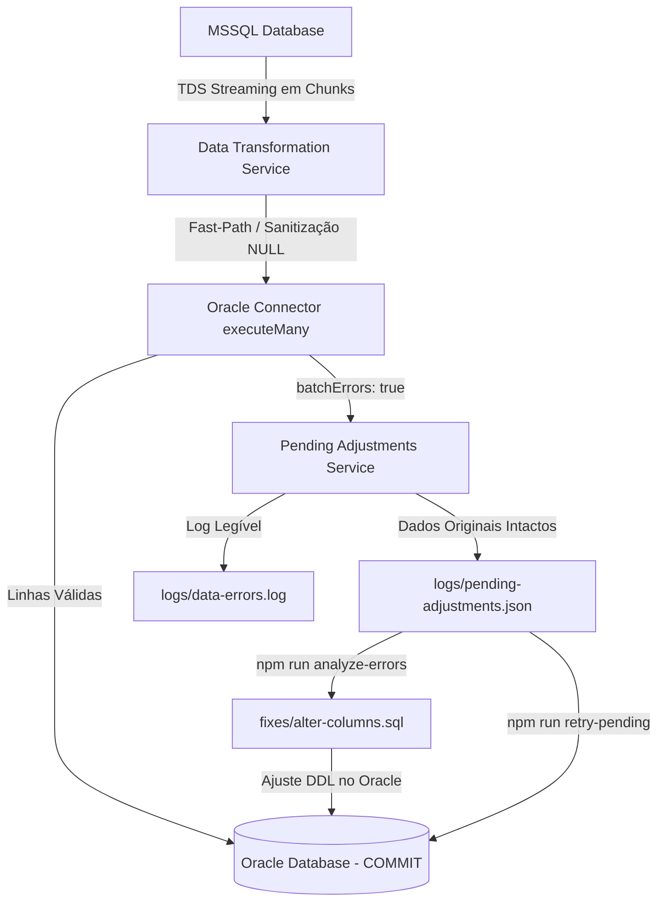

# Conversor de Dados MSSQL para Oracle (High-Throughput Migrator)

Aplicação corporativa de alta performance em **Node.js / TypeScript** e **Docker** para migração massiva e sincronização contínua de dados entre bancos de dados **Microsoft SQL Server (MSSQL)** e **Oracle Database**, com suporte a streaming de alta velocidade, processamento concorrente multi-tabelas, retomada automática por checkpoints e sistema de isolamento de erros com integridade estrita de dados.

Testado e validado em produção em bases com mais de **130 milhões de registros** distribuídos em quase **3.000 tabelas**, atingindo velocidades de transferência superiores a **7.000 linhas/segundo**.

---

## 📋 Sumário

- [Destaques e Recursos](#-destaques-e-recursos)
- [Como o Sistema Funciona](#-como-o-sistema-funciona)
  - [Fluxo de Processamento de Dados](#fluxo-de-processamento-de-dados)
  - [Streaming TDS e Worker Pool](#streaming-tds-e-worker-pool)
  - [Integridade de Dados e Isolamento de Linhas com Falha](#integridade-de-dados-e-isolamento-de-linhas-com-falha)
- [Modos de Operação](#-modos-de-operação)
  - [1. Carga FULL (`migrate:full`)](#1-carga-full-migratfull)
  - [2. Envio INCREMENTAL / Delta (`migrate:incremental`)](#2-envio-incremental--delta-migrateincremental)
  - [3. Retomada Resiliente (`migrate:resume`)](#3-retomada-resiliente-migrateresume)
  - [4. Modo de Teste (`migrate:test`)](#4-modo-de-teste-migratetest)
- [Pós-Migração e Correções DDL](#-pós-migração-e-correções-ddl)
  - [Análise de Erros e Geração de SQLs (`analyze-errors`)](#análise-de-erros-e-geração-de-sqls-analyze-errors)
  - [Re-inserção dos Registros Pendentes (`retry-pending`)](#re-inserção-dos-registros-pendentes-retry-pending)
- [Configuração do Ambiente (`.env`)](#-configuração-do-ambiente-env)
- [Preparação do Banco Oracle (DBA)](#-preparação-do-banco-oracle-dba)
- [Guia de Execução](#-guia-de-execução)
  - [Opção 1: Execução com Docker (Recomendado)](#opção-1-execução-com-docker-recomendado)
  - [Opção 2: Deploy Remoto via `deploy.bat` (Windows ➔ Linux)](#opção-2-deploy-remoto-via-deploybat-windows--linux)
  - [Opção 3: Execução Direta via Node.js](#opção-3-execução-direta-via-nodejs)
- [Acompanhamento de Logs e Relatórios](#-acompanhamento-de-logs-e-relatórios)
- [Estrutura do Projeto](#-estrutura-do-projeto)
- [Solução de Problemas (Troubleshooting)](#-solução-de-problemas-troubleshooting)

---

## ✨ Destaques e Recursos

- ⚡ **Alta Vazão (7.000+ linhas/s):** Leitura via streaming TDS de baixo nível O(N) sequencial (sem o custo proibitivo de paginação por `OFFSET/FETCH`) e inserção em lote com Oracle Thick Mode (`executeMany`).
- 🛡️ **Integridade Estrita de Dados (Sem Truncamento Silencioso):** Nenhuma string é cortada ou modificada durante a migração. Linhas com disparidades de tamanho (`ORA-12899`) ou campos nulos (`ORA-01400`) são isoladas individualmente com fidelidade total dos dados originais para posterior ajuste de schema.
- 🔄 **Sincronização Incremental Inteligente (MERGE / Upsert):** Permite realizar a carga FULL de teste dias antes e, na virada da migração, levar apenas o que foi alterado ou inserido no período, calculando o corte de data automaticamente ou por parâmetro manual.
- 🔁 **Resiliência a Falhas com Checkpoint Thread-Safe:** Gravação automática do estado de cada tabela migrada. Se a conexão cair, a migração retoma exatamente de onde parou sem reprocessar tabelas finalizadas.
- 👥 **Worker Pool Concorrente:** Processamento simultâneo de múltiplas tabelas em paralelo com ordenação decrescente por quantidade de linhas, evitando ociosidade de CPU e rede.
- 🧹 **Reset Automático na Carga FULL:** Ao rodar uma carga FULL, o sistema reconhece a operação como uma nova migração e limpa automaticamente logs antigos, checkpoints e scripts de correção residuais.

---

## 🧠 Como o Sistema Funciona

### Fluxo de Processamento de Dados



### Streaming TDS e Worker Pool

Diferente de migradores convencionais que utilizam consultas com paginação `OFFSET ... FETCH NEXT`, o conversor abre uma conexão de leitura contínua de TDS com o MSSQL. À medida que os blocos de dados chegam pela rede (configurado por padrão em 25.000 linhas), eles são transformados em memória e imediatamente enviados ao Oracle em transações controladas.

O **Worker Pool** permite definir o número de conexões e tabelas processadas simultaneamente (parâmetro `CONCURRENCY`). As tabelas com mais registros são ordenadas no início da fila para que os workers fiquem ocupados uniformemente durante toda a migração.

### Integridade de Dados e Isolamento de Linhas com Falha

Durante a migração de milhões de registros, é comum encontrar colunas com inconsistências no schema de destino (ex: no MSSQL a coluna tinha até 70 caracteres, enquanto no Oracle foi criada com `VARCHAR2(30)`).

Em vez de truncar strings (o que corromperia parâmetros e chaves de negócio) ou falhar a tabela inteira, o conector utiliza a flag `batchErrors: true` do Oracle:
1. **Linhas Válidas:** São normalmente gravadas no banco e confirmadas (`COMMIT`).
2. **Linhas com Erro:** São isoladas por índice dentro do lote. O objeto completo do registro, a coluna afetada e o erro exato do Oracle são salvos intactos em `logs/pending-adjustments.json` e `logs/data-errors.log`.
3. **Pós-Migração:** Após o término da migração principal, o DBA analisa o script gerado automaticamente e aplica o ajuste DDL no Oracle para então re-inserir essas linhas pendentes.

---

## ⚙️ Modos de Operação

| Modo | Comando | Descrição |
| :--- | :--- | :--- |
| **FULL** | `npm run migrate:full` | Carga inicial completa de todas as tabelas. Limpa logs, fixes e checkpoints anteriores. |
| **INCREMENTAL** | `npm run migrate:incremental` | Sincroniza apenas os dados novos ou alterados no período via `MERGE` (Upsert), sem apagar dados existentes. |
| **RESUME** | `npm run migrate:resume` | Retoma uma migração interrompida a partir do último checkpoint registrado. |
| **TEST** | `npm run migrate:test -- --table=NOME` | Valida uma tabela específica antes de migrar a base completa. |

### 1. Carga FULL (`migrate:full`)
- Executa a carga massiva de todas as tabelas mapeadas no MSSQL.
- Se `DISABLE_GLOBAL_CONSTRAINTS=true`, desabilita temporariamente todas as Foreign Keys e Triggers do schema Oracle para máxima velocidade sem erros de chave estrangeira.
- Ao final, reabilita todas as constraints utilizando `ENABLE NOVALIDATE` (validação instantânea).

### 2. Envio INCREMENTAL / Delta (`migrate:incremental`)
Ideal para ser executado no dia da virada de sistema (Go-Live), levando somente a movimentação recente:
- **Corte Automático:** Lê o timestamp da última carga FULL registrada no checkpoint.
- **Corte Manual:** É possível forçar uma data de corte específica:
  ```bash
  npm run migrate:incremental -- --since="2026-07-26 15:00:00"
  ```
- **Estratégias Utilizadas:**
  - *Tabelas com coluna de Data de Alteração e Primary Key:* Executa `MERGE INTO` (Upsert) apenas para `DATA >= corte`.
  - *Tabelas pequenas sem controle de data (<= 50.000 linhas):* Faz reload rápido (`TRUNCATE` + inserção).
  - *Tabelas grandes estáticas sem data:* Mantidas intactas para não degradar a janela de corte.

### 3. Retomada Resiliente (`migrate:resume`)
Caso o container ou o servidor reinicie durante uma carga longa, o modo resume lê o arquivo `checkpoints/migration-checkpoint.json` e filtra automaticamente todas as tabelas já concluídas, continuando apenas com as que faltam.

### 4. Modo de Teste (`migrate:test`)
Valida o pipeline com uma tabela específica para testar conectividade, tipos e permissões:
```bash
npm run migrate:test -- --table=GER_REVENDA
```

---

## 🔧 Pós-Migração e Correções DDL

Quando a migração terminar, execute as ferramentas de auditoria e correção:

### Análise de Erros e Geração de SQLs (`analyze-errors`)
O comando analisa os arquivos de log e pendências (`pending-adjustments.json`) e gera scripts SQL prontos para execução na pasta `./fixes/`:

```bash
npm run analyze-errors
```

Scripts gerados automaticamente em `./fixes/`:
1. `1_disable_constraints.sql`: Desabilita Foreign Keys temporariamente.
2. `2_create_missing_tables.sql`: DDL de criação de tabelas que existiam no MSSQL mas não no Oracle.
3. `3_add_missing_columns.sql`: DDL `ALTER TABLE ... ADD` para colunas faltantes.
4. `4_make_columns_nullable.sql`: DDL `ALTER TABLE ... MODIFY ("COLUNA" NULL)` para colunas que tinham strings vazias no MSSQL e geraram `ORA-01400`.
5. `5_alter_columns_length.sql`: DDL `ALTER TABLE ... MODIFY ("COLUNA" VARCHAR2(X))` expandindo o tamanho de colunas que geraram `ORA-12899`.
6. `6_enable_constraints.sql`: Reabilita todas as restrições com segurança.

### Re-inserção dos Registros Pendentes (`retry-pending`)
Depois que o DBA executar os scripts SQL gerados acima no Oracle (via DBeaver ou SQL*Plus), execute:

```bash
npm run retry-pending
```

O script lê os registros armazenados em `logs/pending-adjustments.json`, insere-os no Oracle e atualiza o arquivo, removendo apenas os registros resolvidos.

---

## ⚙️ Configuração do Ambiente (`.env`)

Copie o arquivo de exemplo `.env.example` para `.env` e configure conforme seu ambiente:

```bash
cp .env.example .env
```

| Variável | Padrão | Descrição |
| :--- | :--- | :--- |
| `MSSQL_HOST` | `localhost` | Endereço do servidor MSSQL (pode incluir instância, ex: `10.5.1.6\MSSQL01`) |
| `MSSQL_PORT` | `1433` | Porta de conexão do SQL Server |
| `MSSQL_DATABASE` | - | Nome da base de dados de origem |
| `MSSQL_USER` | `sa` | Usuário com permissão de leitura (`db_datareader`) no MSSQL |
| `MSSQL_PASSWORD` | - | Senha do usuário MSSQL |
| `ORACLE_HOST` | `localhost` | Endereço do servidor Oracle |
| `ORACLE_PORT` | `1521` | Porta do listener do Oracle |
| `ORACLE_SERVICE_NAME` | `ORCL` | Service Name ou SID do banco Oracle |
| `ORACLE_USER` | - | Usuário/Schema de destino no Oracle |
| `ORACLE_PASSWORD` | - | Senha do usuário Oracle |
| `ORACLE_CONNECTION_STRING`| - | Connection string no formato `host:porta/servico` |
| `MIGRATION_MODE` | `full` | Modo padrão (`full`, `incremental`, `resume` ou `test`) |
| `BATCH_SIZE` | `25000` | Quantidade de linhas por lote de streaming (25.000 a 50.000) |
| `CONCURRENCY` | `4` | Número de tabelas migradas simultaneamente (Worker Pool) |
| `DISABLE_GLOBAL_CONSTRAINTS` | `true` | Desativa Foreign Keys e Triggers do schema antes da carga FULL |
| `AUTO_RESUME` | `true` | Permite retomar pelo checkpoint em caso de interrupção |
| `USE_TRUNCATE` | `true` | Na carga FULL, limpa as tabelas com `TRUNCATE` (com fallback para `DELETE`) |
| `AUTO_ADD_COLUMNS` | `true` | Adiciona colunas ausentes no Oracle automaticamente via `ALTER TABLE` |
| `VALIDATE_DATA_TYPES` | `false` | Se `false`, ativa o fast-path de transformação ultra-rápido |
| `FAST_RELOAD_THRESHOLD` | `50000` | Limite de linhas para reload completo em tabelas sem data no incremental |
| `INCREMENTAL_LOOKBACK_MINUTES` | `30` | Margem de segurança em minutos para o corte da migração incremental |

---

## 🗄️ Preparação do Banco Oracle (DBA)

Antes de iniciar a migração, o schema de destino deve existir no Oracle.

### 1. Criar o Usuário e Configurar Tablespaces
Conecte-se como `SYSTEM` ou `SYS AS SYSDBA` e execute:

```sql
CREATE USER SEU_USUARIO IDENTIFIED BY "sua_senha";
ALTER USER SEU_USUARIO DEFAULT TABLESPACE USERS TEMPORARY TABLESPACE TEMP;
ALTER USER SEU_USUARIO QUOTA UNLIMITED ON USERS;

GRANT CREATE SESSION, CREATE TABLE, CREATE VIEW, CREATE PROCEDURE, CREATE SEQUENCE TO SEU_USUARIO;
```

### 2. Criar a Estrutura de Tabelas (DDL)
A ferramenta transfere os **dados** entre bancos. A estrutura de tabelas vazias deve ser criada previamente no Oracle. Você pode:
- Exportar o DDL de um schema modelo via DBeaver / Oracle SQL Developer e executar no novo usuário; **ou**
- Deixar a opção `AUTO_ADD_COLUMNS=true` para o conversor adicionar colunas que eventualmente faltem na estrutura.

---

## 🚀 Guia de Execução

### Opção 1: Execução com Docker (Recomendado)

O container Docker inclui o **Node.js 18** e o **Oracle Instant Client 19.22** pré-configurados em Thick Mode:

```bash
# 1. Construir a imagem Docker
docker compose build

# 2. Executar teste em uma única tabela
docker compose run --rm converter npm run migrate:test -- --table=GER_REVENDA

# 3. Executar a carga FULL completa
docker compose run --rm converter npm run migrate:full

# 4. Executar carga incremental (somente dados recentes)
docker compose run --rm converter npm run migrate:incremental -- --since="2026-07-26 15:00:00"

# 5. Retomar migração interrompida
docker compose run --rm converter npm run migrate:resume

# 6. Gerar scripts de correção para linhas com erro
docker compose run --rm converter npm run analyze-errors

# 7. Re-inserir linhas pendentes após aplicar correções
docker compose run --rm converter npm run retry-pending
```

---

### Opção 2: Deploy Remoto via `deploy.bat` (Windows ➔ Linux)

Se você desenvolve na máquina Windows e executa as migrações em um servidor Linux dedicado:

1. **Configuração Local Privada:**
   Crie um arquivo chamado `deploy.local.bat` na raiz do projeto (ele já está no `.gitignore` para nunca ser enviado ao repositório):
   ```cmd
   @echo off
   set DEST=usuario@10.5.1.83:~/Conversor-MSSQL-Oracle/
   ```

2. **Enviar os Arquivos:**
   Execute o script:
   ```cmd
   .\deploy.bat
   ```
   *O script envia a pasta `src/`, `package.json`, `tsconfig.json`, `Dockerfile` e `docker-compose.yml` para o servidor via SCP solicitando a senha uma única vez.*

3. **Conectar no Servidor e Executar:**
   ```bash
   ssh usuario@servidor-linux
   cd ~/Conversor-MSSQL-Oracle
   docker compose build
   docker compose run --rm converter npm run migrate:full
   ```

---

### Opção 3: Execução Direta via Node.js

Para executar localmente sem Docker, é necessário ter o [Oracle Instant Client](https://www.oracle.com/database/technologies/instant-client/downloads.html) instalado na máquina.

```bash
# 1. Instalar dependências
npm install

# 2. Compilar TypeScript
npm run build

# 3. Executar a migração desejada
npm run migrate:full
```

---

## 📊 Acompanhamento de Logs e Relatórios

Durante e após a migração, os seguintes arquivos são gerados na pasta `./logs/`:

- **`logs/migration.log`**: Log em tempo real com o status de cada lote e tabela processada.
- **`logs/data-errors.log`**: Linhas individuais que violaram restrições no Oracle, com os dados brutos salvos.
- **`logs/pending-adjustments.json`**: Estrutura JSON com os registros pendentes prontos para serem reprocessados pelo `retry-pending`.
- **`logs/skipped-tables.log`**: Tabelas existentes no MSSQL que foram ignoradas por não existirem no schema do Oracle.
- **`logs/migration-report-YYYY-MM-DD.txt`**: Relatório final consolidado exibindo:
  - Total de tabelas processadas, concluídas e com falha;
  - Total de linhas processadas e taxa de sucesso;
  - Tempo total de duração e velocidade média em linhas/segundo.

Para acompanhar os logs em tempo real no servidor Linux:
```bash
tail -f logs/migration.log
```

---

## 📁 Estrutura do Projeto

```
conversor-mssql-oracle/
├── checkpoints/              # Checkpoints de retomada (JSON)
├── fixes/                    # Scripts SQL corretivos gerados pelo analyze-errors
├── logs/                     # Arquivos de log e relatórios de execução
├── src/
│   ├── config/               # Configurações de banco e migração (.env)
│   ├── connectors/           # Conectores MSSQL (TDS Stream) e Oracle (Thick Mode)
│   ├── migrations/           # Orquestrador de migração concorrente
│   ├── models/               # Modelos de dados, tabelas e checkpoints
│   ├── scripts/              # Utilitários de análise de erros e re-inserção
│   ├── services/             # Lógica de negócio (leitura, transformação, inserção)
│   └── utils/                # Mapeamento de tipos, validação e logger
├── Dockerfile                # Imagem Docker com Node 18 e Instant Client 19.22
├── docker-compose.yml        # Configuração de containers e volumes
├── deploy.bat                # Script de envio automatizado Windows -> Linux
├── package.json              # Dependências e scripts npm
├── tsconfig.json             # Configuração do TypeScript
└── README.md                 # Este guia completo de documentação
```

---

## 🔍 Solução de Problemas (Troubleshooting)

### 1. `ORA-00054: resource busy and acquire with NOWAIT specified`
- **Causa:** Tentativa de executar `ALTER TABLE` ou `TRUNCATE` enquanto outra sessão ou transação mantinha um lock na tabela.
- **Solução:** Verifique sessões ativas no Oracle (`v$session`, `v$locked_object`). Aplique o comando manualmente e rode `npm run migrate:test -- --table=NOME_DA_TABELA`.

### 2. `ORA-12899: value too large for column`
- **Causa:** O tamanho da string no MSSQL é maior do que o definido na coluna do Oracle (ex: 70 chars vs `VARCHAR2(30)`).
- **Solução:** O conversor não trunca os dados para não corromper parâmetros. Execute `npm run analyze-errors`, aplique o script gerado em `./fixes/5_alter_columns_length.sql` e execute `npm run retry-pending`.

### 3. `ORA-01400: cannot insert NULL into ...`
- **Causa:** Strings vazias `""` no MSSQL são tratadas pelo Oracle nativamente como `NULL`. Se a coluna for `NOT NULL`, o Oracle rejeita a linha.
- **Solução:** Execute `npm run analyze-errors` para gerar o script `./fixes/4_make_columns_nullable.sql`, execute no Oracle e rode `npm run retry-pending`.

### 4. `NJS-040: connection request timeout`
- **Causa:** O pool de conexões do Oracle ficou sobrecarregado aguardando conexões livres em tabelas gigantescas.
- **Solução:** O conector já possui timeout aumentado para 300 segundos (`300000ms`) e pool ampliado. Certifique-se de que `CONNECTION_POOL_MAX` no `.env` esteja configurado com pelo menos `20` a `30`.

---

## 📄 Licença

Este projeto é distribuído sob a licença [MIT](LICENSE).
